# Pattern Studio

A design tool for building surfaces made of many small parts: perforated and cut metal screens, tilted-disc facades, glass, brick, timber, serial ribs, kinetic units and paved grounds. You design a surface, the tool checks whether it can be built, and it gives you the drawings, schedules, cutting files and robot programs to make it.

Built for ARCH 540 (UBC M.Arch), Assignment 2. State of 20 November 2026.

**▶ [Open the tool](https://balreetdhatt.github.io/Pattern-Studio-Nov-20-Progress/)** (runs in your browser, nothing to install)

Also published as a Claude artifact: [Pattern Studio, Version 139](https://claude.ai/artifact/X9kjU9vH4RqwFcqBY7NKNW)

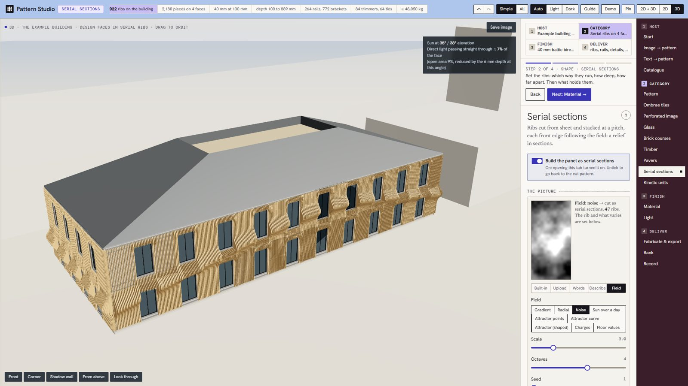

---

## Open it

**Online:** <https://balreetdhatt.github.io/Pattern-Studio-Nov-20-Progress/>

**On your own computer:** download this repository (Code → Download ZIP), unzip it and open `index.html` in a web browser. That is the whole install: no build step, no server, no account.

- Chrome or Edge on a laptop or desktop works best. The 3D view needs WebGL.
- The page loads two things from the internet the first time: the 3D library (three.js r128 from cdnjs) and the fonts. After that it works offline.
- On GitHub Pages, `index.html` is the tool itself. `tool/pattern-studio.html` is the same file.
- A large design (a whole brick building, 50,000 bricks) can take a few seconds to build. Wait for the 3D view to settle before clicking again.

---

## Your first design in five minutes

1. The tool opens on **Start**. Click any card. Each card is a finished design you can change. Try **Ribs round the building** or **The example building in real brick**.
2. Look at the two views. **2D** (left) is the drawing: an elevation, a plan, a course drawing or a sheet of details. **3D** (right) is the model. Drag to orbit, scroll to zoom, right-drag to pan.
3. The tab that opened on the left holds the controls for that design. Each tab is split into numbered **steps** across the top (for example Wall, Brick, Bond, Pattern, By hand, Check, Deliver). Work through them left to right, or jump to the one you need.
4. Open the **Check** step. It lists, in plain sentences, what the tool found: green is fine, amber is a warning, red is something that would not build. Every number there is a first check for a designer, not an engineer's design, and says so.
5. Open **Deliver**, or the **Fabricate & export** tab, and click **Download the bundle**. You get a zip with the drawings, schedules, cutting files and robot programs for the design.

The bar at the top of the controls (Host, Category, Finish, Deliver) shows where you are. **Next** and **Back** under it walk you through the steps.

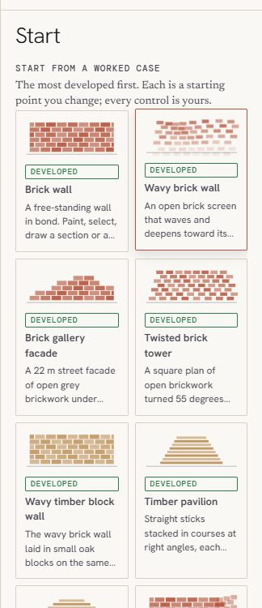

---

## The tabs

The tabs run down the left edge, grouped by what they are for.

### Begin
| Tab | What it does |
|---|---|
| **Start** | Ready-made designs to begin from, grouped as developed and still developing. Also: **Compose** (the tool makes a new design from the logic of its case-study library, on a form you choose) and four other ways in (words, a picture, your own plan line, a surface from the library). |
| **Image → pattern** | Upload a photograph. The tool finds the repeating pattern in it (its symmetry and repeat) and turns it into a cut pattern, or uses the picture itself as the tone for a facade. |
| **Text → pattern** | Describe a design in words. The tool reads it and proposes a pattern, which you then edit. |
| **Catalogue** | 46 case studies, each read down to its rule. Cards marked as loading well open as a working design. The tool learns from these; it never copies them. |

### Panel kinds
| Tab | What you make |
|---|---|
| **Pattern** | A cut or embossed sheet: tilings, star patterns, motif lattices. |
| **Coin facade** | Hundreds of tilted metal discs. Each disc is turned so it reflects a chosen tone of sunlight, so together they hold a picture that changes as the sun moves. |
| **Perforated image** | A sheet whose hole sizes carry a picture. What is behind the sheet, and light at night, decide how it reads. |
| **Glass** | Etched, sandblasted, fritted, kiln-formed or film-printed glass, pane by pane, with a bird-safety check. |
| **Brick courses** | Real brickwork, brick by brick: bonds, corners, openings with lintels and sills, turned or pushed or recessed bricks by rule, chance or a drawn curve, brick mixes, and buildings as prefabricated elements. Every brick is checked to bear on the bricks below. |
| **Timber** | Walls and pavilions in wood: bent lattice walls, bent plywood shells, slat walls, a wall of timber blocks, an interlocking plywood tunnel, a stacked-stick pavilion and more, each with its joinery. |
| **Serial sections** | Ribs cut from sheet and set side by side: a relief screen, or ribs cut from a body (a bench running into a canopy, an arched passage) with rods, spacers and a footing, plus laser-cut model kits. |
| **Kinetic units** | Units that open and close with the sun, a walker or the wind: petals, irises or louvres. |
| **Pavers** | Paved grounds: many layouts, a permeable family, counted pavers that fill a ground from a list, planting, benches, slopes, terraces, steps, ramps and a water check. |

### Finish and deliver
| Tab | What it does |
|---|---|
| **Material** | The material and its thickness (stock gauges). |
| **Light** | Sun position by place, month and hour; night lighting. |
| **Fabricate & export** | The bundle of files. Also how a sheet panel is hung (three hanging systems with detail sheets), and **A model of the building** (see below). |
| **Bank** | Designs you have saved. They are kept in your own browser. |

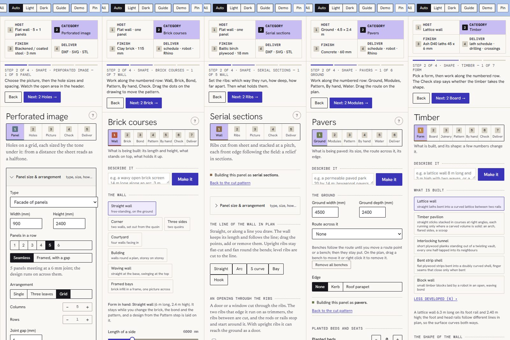

---

## Working by hand

Most tabs have a **By hand** step. Dots and lines on the 2D drawing are the controls:

- **Drag** a dot to move what it drives (a swell in a brick wall, a route through a paved ground, the curve that shapes the ribs).
- **Double-click** to add a point. **Right-click** to remove one. **Scroll** on a dot to change its strength or reach.
- **Paint** marks where an effect happens (bricks pushed out, pavers opened up). **Select** a box of bricks to change just those.
- **Hover** over a brick to read what it is doing and why.

The **Field** picker (in the picture block of most tabs) decides what drives a design: a photograph, a gradient, noise, the sun, attractor points, or **Attractor (shaped)**, a set of curves you draw with their own falloff.

---

## The example building

The tool carries one real building to test designs on: a two-storey block, 41 by 16 m, taken from a Rhino model, with its own 56 windows. Open it from Start (**Building from a Rhino model**) or from Fabricate & export → **A model of the building** → **Rhino example building**.

On it you can try every panel kind. What the tool does there:

- **Panels are cut round the windows**, with folded returns, reveals and sills, or run **over** the windows, face by face. **Panels that follow the windows** finds a panel width with no thin slivers.
- **One picture** can run across one, two, three or all four faces.
- **Corners are made of the panels themselves**: folded cassettes, a folded plate, a notched board joint, bonded brick quoins, a shared frame angle for kinetic units, mitred timber slats, a fan of ribs. No posts or filler strips.
- **Ribs** are slices of one surface round the whole building, hung storey by storey on rails, with a hem and crown that can lift and dip, and an optional turn toward a sight point.
- **Mesh shutters**: bi-fold, sliding or fold-out bays at the windows that open in the 3D view.
- **Timber slats**: a ventilated rainscreen with six designs.
- **Real brick**: the whole building laid brick by brick, with the brick patterns on it.
- **A plaza** in front of the entrance face, falling away from the building.

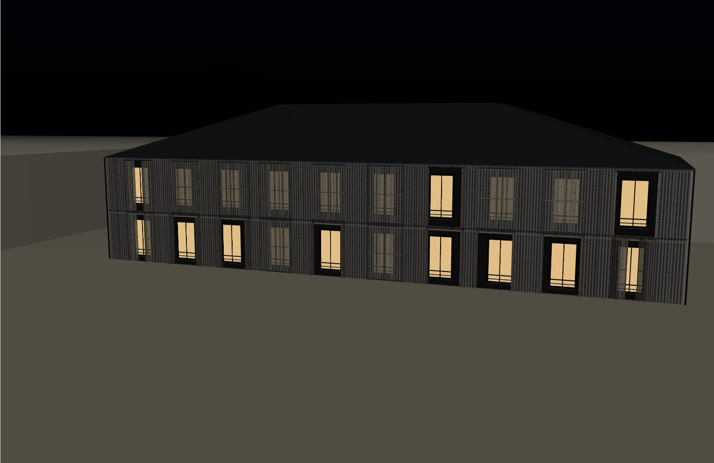

| | |
|---|---|
| 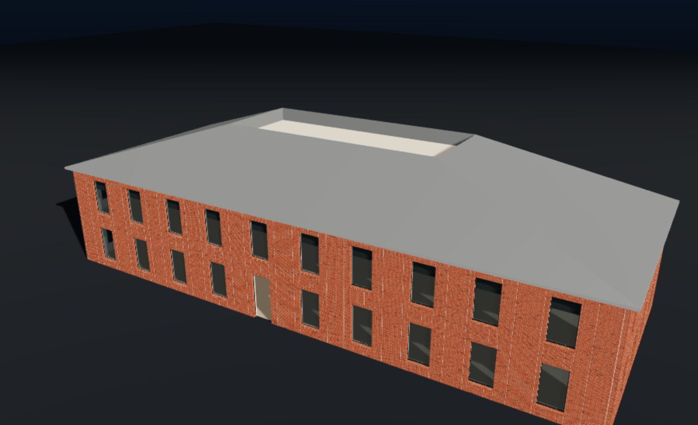 | 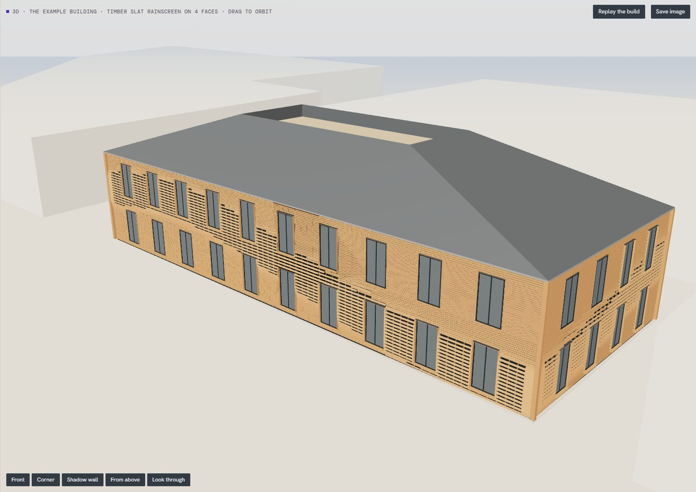 |
| 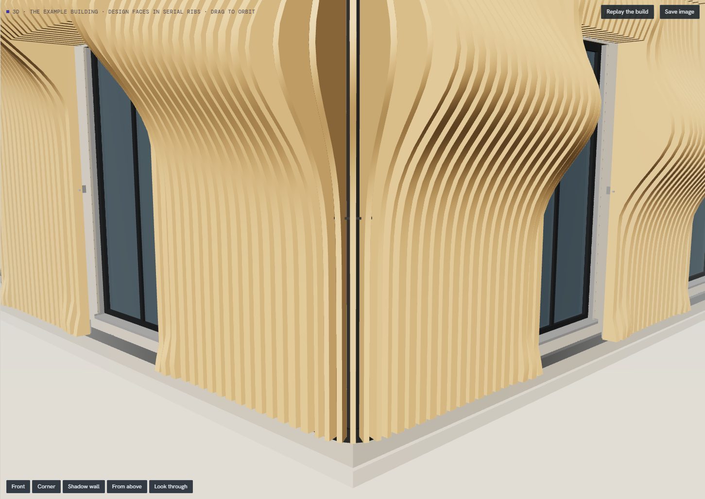 | 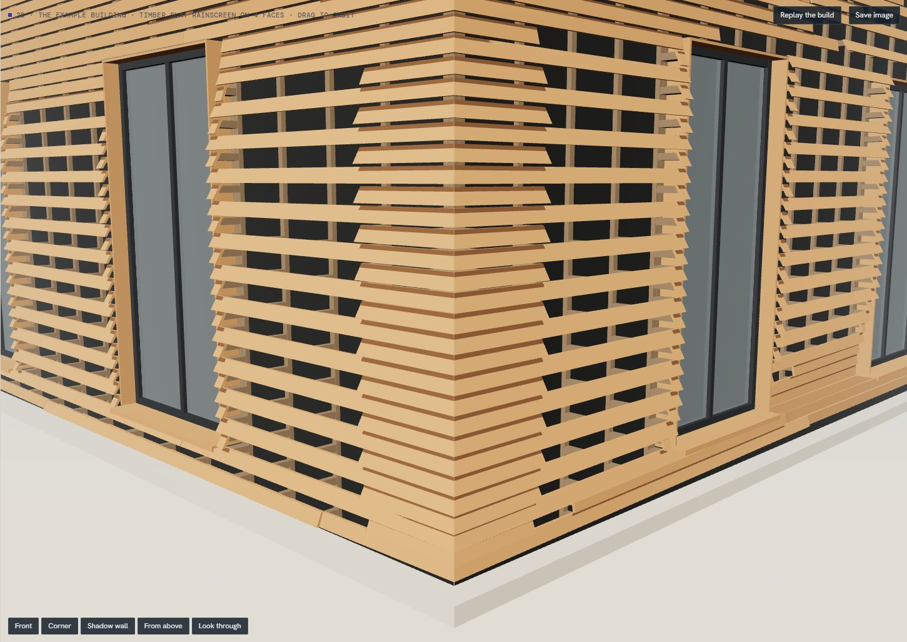 |

---

## Some designs to try

Steps assume you start from a fresh page.

**Ribs round the building**
1. Start → **Ribs round the building**.
2. In the Field picker choose **Attractor (shaped)**, pick a face, and drag the curve's points.
3. Fabricate & export → A model of the building → **How the ribs are carried (details)**.

**Mesh shutters**
1. Start → **Mesh shutters on the building**.
2. Slide **How far open**; choose closed, open, lived in, or closed in the sun.
3. Light → **Night** to see the rooms lit behind the mesh.

**A patterned brick building**
1. Start → **The example building in real brick**.
2. Brick courses → step 4 Pattern → **Patterns by rule** → **Pleated wall** or **Dogtooth bands**.
3. Step 6 Check confirms every brick bears.

**Bench wall into canopy**
1. Start → **Sectioned bench and canopy**.
2. Change length and height; open the wall, seat and canopy folds.
3. **Model kit** gives laser files for a model at 1:5 to 1:50.

**Stepped terrace garden**
1. Pavers → step 1 Ground → **Stepped terrace garden**.
2. Set the number of terraces and the falls under **Terraces and the graded edge**.

| | |
|---|---|
| 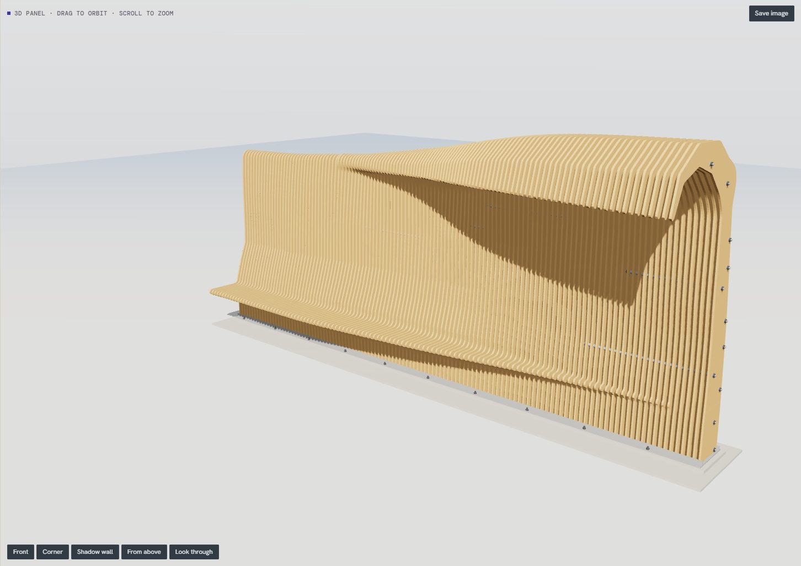 | 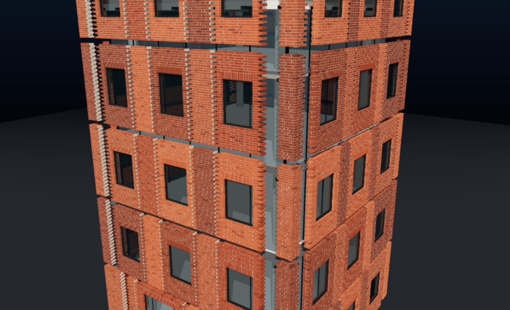 |
| 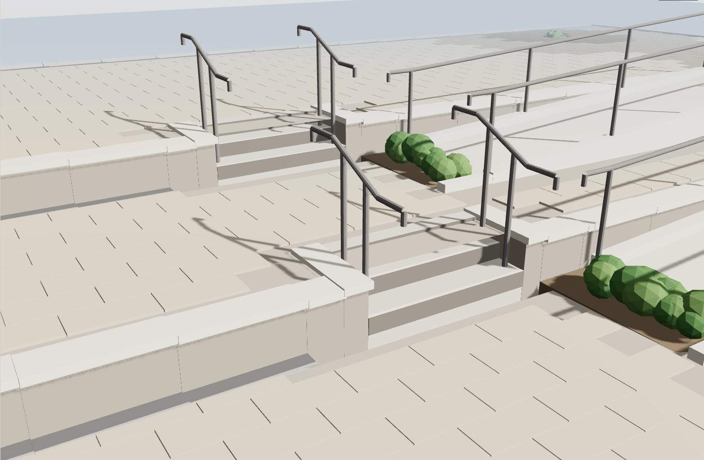 | 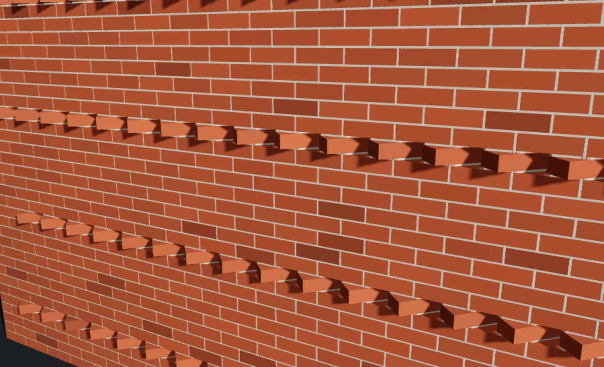 |

---

## What you get out

**Download the bundle** writes a zip named after the design. Depending on the kind, it holds:

- **Drawings**: SVG and DXF cutting files (laser, waterjet or router, with the kerf allowed for), elevations, plans, detail sheets, laying plans, grading plans.
- **Schedules** (CSV): every panel, brick, slat, rib, paver or tile with its size and place; cut lists with the stock to buy; fixings.
- **3D**: STL for printing and OBJ for Rhino.
- **Robot programs**: a placement list (CSV) and a KUKA KRL program (`.src`) for a generic cell. These are illustrative; check them in your own cell's simulation before running anything.
- **Rhino / Grasshopper readers** that rebuild the design from its schedules.
- **A README** in the zip saying what each file is.

---

## Rhino and Grasshopper

`grasshopper/` holds Python scripts and Grasshopper definitions (`.ghx`) for Rhino 8:

- `*_from_csv.py` rebuild a design from the tool's schedules (bricks, pavers, ribs, tiles, timber, robot paths).
- `*_on_surface.py` / `.ghx` generate units directly on a Rhino surface.
- `assembly.ghx` chains walls, a vault and a skin.

See `grasshopper/README.md`. Most were run in Rhino 8; the README says which were not.

---

## Limits, honestly

- **Structure**: every bearing, wind, bending or weight figure is a first check by rule of thumb, said as such in the tool. A structural engineer must check anything you build.
- **Fabrication**: hardware sizes (brackets, hooks, rails, bolts) are first statements for a fabricator to detail.
- **Robots**: robot programs assume a generic cell and have no collision check.
- **Drawings in 3D**: some parts (corner pieces, linings) are drawn as thin sheets; the schedules carry their real sizes.
- **Checked by**: 388 automated checks pass. Designs were looked at in rendered pictures; not every drag and click has been tried with a real mouse.
- **Your designs** are saved only in the browser you made them in. Download the bundle or the design file to keep them.

---

## For developers

- `tool/pattern-studio.html` is the whole tool in one file (HTML, CSS, JavaScript). `index.html` is a copy for GitHub Pages.
- `tool/DEVELOPER-NOTES.md` describes every pass of work (181 of them), the state names, the functions and the rules learned.
- **Tests**: from `tool/`, run `python qa/run-qa.py` (needs Python 3 and Google Chrome). It builds a copy of the tool with `qa/harness.js` inside, runs 388 checks in headless Chrome and writes `qa/report.md`. `--group brick` (or another group name) runs one group. Use `QA_TAG=mine-` if two runs share a machine.

---

## Credits and attribution

- **Coin facade**: an independent reconstruction of the reflected-light principle of Ombrae™ / OpticalTile™ / Sculptural Imaging™, marks of Ombrae Studios and KPS (Keith Panel Systems). Tile dimensions are from figures KPS publish. This is not their process or their software; anything built from it needs their licence. Keep this notice with the files.
- **Perforated image**: an independent reconstruction of the principle of perforated picture panels (such as Zahner ImageWall and Imark Ocular), not their process.
- **Case studies**: the catalogue reads the rule behind published projects. Designs made with the tool synthesise those rules; none reproduces a project. Source images and book pages are not included in this repository.
- **The example building** is from the author's own Rhino model.
- Built with [three.js](https://threejs.org) r128.
